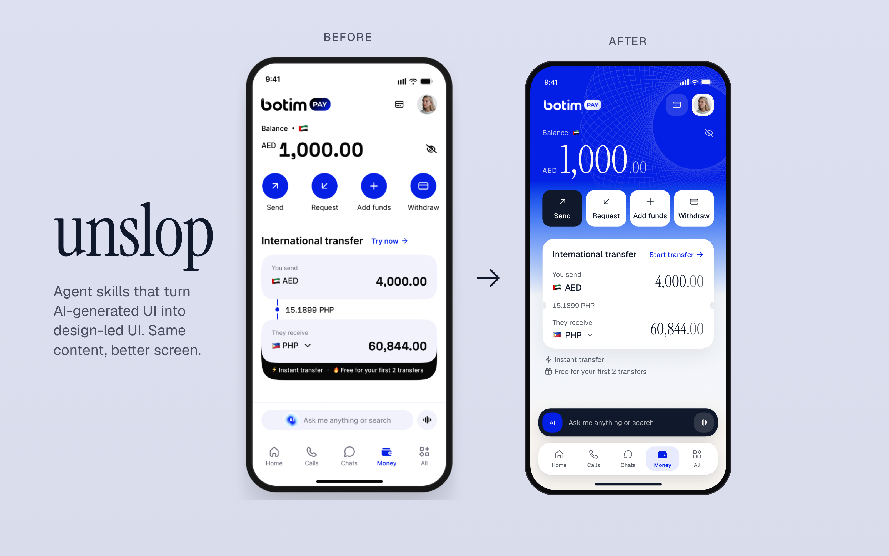

# Unslop

[](https://skills.sh/bogdanptr/unslop)

Agent skills that take any AI-generated interface and turn it into one that looks designed, without changing what it says.

AI design tools produce screens that are tidy and legible and all look the same: indigo on gray, every group in a bordered card, icons in tinted squares, a row of stat cards, a ring around the main number. Unslop gives your coding agent the method a senior product designer would use to fix that. It records what the screen contains, finds the defaults, commits to one idea taken from the product, and restyles in a fixed order, judged against the fundamentals of hierarchy, grouping, alignment, contrast and restraint. The data, the copy and the actions come out the other side intact.

It is a generalist. Dashboards, tables, settings and forms, landing pages, feeds, mobile screens and flows each get a treatment that fits: a work screen stays dense and quiet, a landing page can be loud.

Works on Figma frames, on code and on screenshots. Built for Claude Code, Codex, Cursor and any agent that reads skills.

## Why use it

Agents can build a working screen in a minute, and it looks like every other screen an agent built that minute. Asking for "more modern" or "premium" changes the colors and keeps the template.

Unslop gives the agent what a senior designer has and a model does not: an order of work, a reason behind every choice, and a list of the defaults to avoid. It also gives it one hard rule. The content you gave it comes back unchanged.

## Install

### Claude Code

As a plugin, which installs the skills and three subagents (an auditor, a screen worker and a critic):

```
/plugin marketplace add bogdanptr/unslop
/plugin install unslop@unslop
```

Or as plain skills:

```bash
npx skills@latest add bogdanptr/unslop -a claude-code
```

### Codex

```bash
npx skills@latest add bogdanptr/unslop -a codex
```

### Cursor and other agents

```bash
npx skills@latest add bogdanptr/unslop
```

The installer asks which agents to install for. To install one skill only, add `--skill`:

```bash
npx skills@latest add bogdanptr/unslop --skill unslop-diagnose
```

## Use

Point your agent at a screen and ask. A Figma link, a path in your project or a pasted screenshot all work.

**Claude Code**

```
/unslop https://www.figma.com/design/…?node-id=12-34
```

```
/unslop the dashboard in src/app/home, keep everything, just restyle
```

**Codex**

```
$unslop restyle the settings page in app/settings
```

**Any agent, in plain words**

```
unslop this screen and make it look premium
```

```
why does this screenshot look AI-made?
```

What you get back: the restyled screen, a before and after table with the reason for each change, and a ledger showing where every piece of the original content went.

- **Figma:** connect a Figma MCP server with write access. The restyled frame is written as a copy beside the original, which is never edited.
- **Code:** the work happens on a branch and touches presentation only.
- **Screenshot:** you get one self-contained HTML file at the size of the original.

## How it works

```
 source            contract          diagnose         direction
 Figma / code  →   every value   →   which defaults → one idea,
 / screenshot      and action        give it away     five dials
                                                          │
   ┌──────────────────────────────────────────────────────┘
   ▼
 1 layout → 2 surfaces → 3 figures → 4 type → 5 color → 6 navigation → 7 material
                                                                       │
                                        report  ←  verify  ←───────────┘
                                                   content parity,
                                                   contrast, tells
```

Structure comes before skin. The order is the one a designer would follow by hand: decide what the view is about and cut the rest, clean up the boxes, put each figure, chart and table in the form that fits it, set the type, choose the background and take every color from it, simplify the navigation, and apply the material last. A pass whose subject the screen does not have is skipped.

Three modes:

| Mode | Changes |
| --- | --- |
| `full` | Look and structure. Elements may be cut or demoted, each one listed in a ledger |
| `reskin` | Look only. Same elements, same labels, same navigation |
| `audit` | Nothing. Reports what makes the screen look generated |

## Example

The cover above is a wallet screen from a screenshot: same balance, same actions, same tabs, new screen. [examples/sleep](examples/sleep) is a full run on another generated screen, a mobile summary view: the original, the result, the report and what verification caught. It is one case, not the template. A dashboard or a form comes out flat, dense and quiet.

## Skills

### Run the whole thing

- [**unslop**](skills/unslop/SKILL.md): The orchestrator. Takes a screen in, writes the content contract, runs every pass in order, verifies and reports.

### The basis

- [**unslop-principles**](skills/unslop-principles/SKILL.md): The design fundamentals every pass is judged by, each with a test you can run on a screenshot, and what "premium" means as decisions.

### Understand the screen

- [**unslop-diagnose**](skills/unslop-diagnose/SKILL.md): Finds the tells, from default palettes to boxed icons, and ranks them by how much of the generic look each carries. Read-only.
- [**unslop-direction**](skills/unslop-direction/SKILL.md): Names the kind of screen, picks the one idea the restyle is built on and writes it as a brief of five dials: atmosphere, signature, type voice, material, accent source.

### Restyle it, in this order

- [**unslop-layout**](skills/unslop-layout/SKILL.md): One focal point per view, fewer sections, no uniform card grid or leading stat-card row, one spacing scale.
- [**unslop-surfaces**](skills/unslop-surfaces/SKILL.md): Removes borders, icon tiles and glows, settles one radius family, gives buttons and inputs one style, and applies the material (flat, paper, matte or glass) as the final step.
- [**unslop-dataviz**](skills/unslop-dataviz/SKILL.md): Picks chart forms from what the reader compares, replaces rings and donuts, cleans up tables and sets how numbers and units are drawn.
- [**unslop-typography**](skills/unslop-typography/SKILL.md): A typeface with a voice, a scale that fits the kind of screen, lighter big text, hierarchy from tone.
- [**unslop-color**](skills/unslop-color/SKILL.md): Builds the background, usually a quiet tinted neutral, derives the palette from it, keeps one accent and measures contrast.
- [**unslop-navigation**](skills/unslop-navigation/SKILL.md): Fewer items in tab bars, sidebars and top navigation, clearer names, shorter button labels, with every destination still reachable.

### Read and write

- [**unslop-figma**](skills/unslop-figma/SKILL.md): Reads a frame through a Figma MCP server and writes the result as a copy.
- [**unslop-code**](skills/unslop-code/SKILL.md): Restyles a coded screen without touching behavior, and builds from a screenshot when there is no source.

### Check it

- [**unslop-verify**](skills/unslop-verify/SKILL.md): Confirms every value and action survived, re-scans for tells, measures contrast and returns `Ship` or `Fix first`. Read-only.

## Which skill for which prompt

| You say | Skill |
| --- | --- |
| "Unslop this screen" / "make this look premium" | `unslop` |
| "Why does this look AI-generated?" | `unslop-diagnose` |
| "Something feels off and I can't say what" | `unslop-principles` |
| "This has no concept, give it a direction" | `unslop-direction` |
| "Everything has the same weight" / "too many cards" | `unslop-layout` |
| "Too many borders" / "get the icons out of those boxes" | `unslop-surfaces` |
| "This donut could be in any app" / "the table is hard to scan" | `unslop-dataviz` |
| "The text feels heavy" / "it's all Inter" | `unslop-typography` |
| "It feels flat" / "it's all purple" | `unslop-color` |
| "Five tabs is too many" / "this sidebar has everything in it" | `unslop-navigation` |
| "Did the redesign keep everything?" | `unslop-verify` |

Each skill works on its own. The orchestrator is the reason to install all of them.

## What it will not do

- **Invent content.** No new metrics, names, dates or testimonials. If a new hero needs data the screen does not have, it draws a marked placeholder and tells you which field is missing.
- **Change values.** `7h 42m` stays `7h 42m`.
- **Lose things silently.** Whatever is cut, merged or moved appears in the ledger with where it went.
- **Edit your original.** Figma work goes on a copy, code work on a branch.
- **Touch behavior.** No changes to data fetching, state, routing or logic.
- **Override a brand.** Documented colors and typefaces are fixed. The direction works around them.

## Subagents

Three roles run better in their own context, and ship as Claude Code agents in [`agents/`](agents):

- **unslop-auditor** diagnoses the source without knowing the plan.
- **unslop-screen-worker** restyles one screen from a locked brief, so several screens run in parallel.
- **unslop-critic** verifies the result without having watched the work.

In other harnesses, the orchestrator spawns general agents with the same briefs, or runs the roles in sequence. See [subagents.md](skills/unslop/subagents.md).

## Credits

The structure of this collection, one folder per skill, an orchestrator over domain skills, exact values and a detection table in each, is modeled on two sets of skills worth installing alongside it:

- [emilkowalski/skills](https://github.com/emilkowalski/skills) by Emil Kowalski, for motion and design engineering.
- [jakubkrehel/skills](https://github.com/jakubkrehel/skills) by Jakub Krehel, for typography, color, layout, accessibility and UI polish.

Unslop covers restyling. For animation, accessibility review and deep typographic or color-system work, use theirs.

## License

MIT
